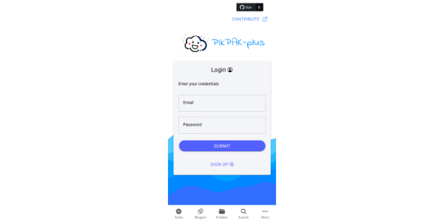
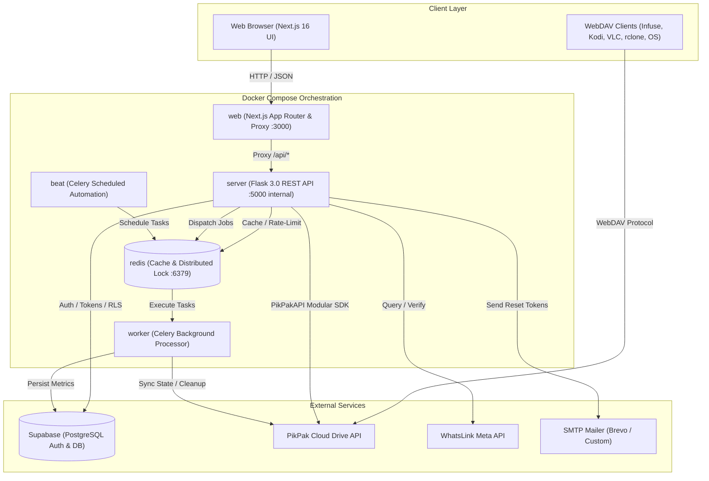

[![Contributors][contributors-shield]][contributors-url]
[![Forks][forks-shield]][forks-url]
[![Stargazers][stars-shield]][stars-url]
[![Issues][issues-shield]][issues-url]
[![License][license-shield]][license-url]
[![Release][release-shield]][release-url]
[![Next.js][nextjs-shield]][nextjs-url]
[![React][react-shield]][react-url]
[![Flask][flask-shield]][flask-url]
[![Docker][docker-shield]][docker-url]
[![Tests][tests-shield]][tests-url]
[![LinkedIn][linkedin-shield]][linkedin-url]

<br />

<p align="center">
  <a href="https://github.com/bharathganji/pikpak-plus/">
    
  </a>

  <h3 align="center">unofficial implementation of <a href="https://mypikpak.com/drive/activity/invited?invitation-code=47295398">PikPak</a></h3>

  <p align="center">
    Share your PikPak [Premium] cloud storage with friends and family seamlessly, safely, and efficiently!
    <br />
    <a href="#getting-started"><strong>Explore the docs »</strong></a>
    <br />
    <br />
    <a href="https://github.com/bharathganji/pikpak-plus/issues">Report Bug</a>
    ·
    <a href="https://github.com/bharathganji/pikpak-plus/issues">Request Feature</a>
  </p>
</p>

<details open="open">
  <summary><strong>Table of Contents</strong></summary>
  <ol>
    <li>
      <a href="#about-the-project">About The Project</a>
      <ul>
        <li><a href="#key-features">Key Features</a></li>
        <li><a href="#system-architecture">System Architecture</a></li>
        <li><a href="#built-with">Built With</a></li>
        <li><a href="#repository-structure">Repository Structure</a></li>
      </ul>
    </li>
    <li>
      <a href="#getting-started">Getting Started</a>
      <ul>
        <li><a href="#prerequisites">Prerequisites</a></li>
        <li><a href="#docker-compose-deployment-recommended">Docker Compose Deployment (Recommended)</a></li>
        <li><a href="#environment-configuration">Environment Configuration</a></li>
        <li><a href="#database-setup-supabase">Database Setup (Supabase)</a></li>
      </ul>
    </li>
    <li><a href="#local-development-setup">Local Development Setup</a></li>
    <li>
      <a href="#feature-overview--usage">Feature Overview & Usage</a>
      <ul>
        <li><a href="#-offline-download-manager">Offline Download Manager</a></li>
        <li><a href="#-smart-share-links--global-deduplication">Smart Share Links & Global Deduplication</a></li>
        <li><a href="#-webdav-access--client-setup">WebDAV Access & Client Setup</a></li>
        <li><a href="#-storage--quota-analytics">Storage & Quota Analytics</a></li>
        <li><a href="#-centralized-admin-portal">Centralized Admin Portal</a></li>
        <li><a href="#-automated-email--password-recovery">Automated Email & Password Recovery</a></li>
      </ul>
    </li>
    <li><a href="#testing--quality-assurance">Testing & Quality Assurance</a></li>
    <li><a href="#living-documentation--architecture-records">Living Documentation & Architecture Records</a></li>
    <li><a href="#automated-release-process">Automated Release Process</a></li>
    <li><a href="#contributing">Contributing</a></li>
    <li><a href="#license">License</a></li>
    <li><a href="#contact">Contact</a></li>
    <li><a href="#acknowledgements">Acknowledgements</a></li>
  </ol>
</details>

---

## About The Project

**PikPak Plus** is an enterprise-grade self-hosted web platform that extends the [PikPak](https://mypikpak.com/drive/activity/invited?invitation-code=47295398) cloud storage service. It enables account holders to securely share their single PikPak Premium subscription with family, team members, or friends without disclosing master account credentials.

Users get an intuitive web drive interface to paste magnet links, track cloud downloads, stream videos, browse shared drives, generate WebDAV access tokens, and view real-time quota metrics. Administrators retain complete oversight via granular content moderation and system health monitoring.

### Key Features

- ⚡ **Modular SDK Engine (`PikPakAPI`)**: Built-in 21-module async/sync SDK with 57 public methods, sliding-window rate limiter (3 req/s ceiling, 60s login cooldown), and circuit breaker with `Retry-After` backoff to prevent account or IP bans.
- 🔐 **Hardened Enterprise Auth**: 3-tier auth guardian with `asyncio.Lock` concurrency protection, secure `HttpOnly` cookie-based sessions with `Clear-Site-Data` logout, persistent JWT secrets across multi-worker Gunicorn nodes, POSIX user environment collision isolation, and right-to-left XFF proxy header validation to block IP spoofing.
- 📥 **Offline Download Management**: High-speed magnet, hash, and download task management with real-time status updates, bulk deletion support, and automated 24h task cleanup.
- 🔍 **Public Torrent Search**: Integrated torrent search enabling users to find and fetch magnets without external indexers.
- 🔗 **Smart Link Deduplication**: Global share deduplication ensures exactly one share link per file is created and reused across all users, slashing API churn and quota waste. Includes batch deletion for active shares.
- 📁 **Automated WebDAV Provisioning**: Auto-generates rotating WebDAV clients every 24 hours for direct mounting in Windows Explorer, macOS Finder, Linux, Infuse, Kodi, VLC, and rclone.
- 📊 **Quota & Storage Analytics**: Real-time tracking of VIP tier status, expiration countdowns, bandwidth, storage consumption, and 30-day historical trend graphs.
- 🛠️ **Centralized Admin Console**: Access `/admin` to monitor active users, ban/unban accounts, audit system logs, and permanently delete tasks or files with one click.
- ✉️ **Password Reset & Email Notifications**: Automated token-based password reset flows with Brevo (Sendinblue) or standard SMTP support, featuring fallback to secure console logging.
- 🎨 **Modern High-Performance UI**: Next.js 16 App Router, React 19, Tailwind CSS v4, virtualized lists (`virtual-list.tsx` with $O(\log N)$ slice lookup) supporting smooth 60fps scrolling over 1,000+ items, loading skeletons, and multi-tier error boundaries.
- 🛡️ **Zero Upstream Exposure**: Upstream PikPak master passwords are never stored in browser storage or transmitted to client sessions. The Flask backend is isolated behind internal Docker container networking.

---

### System Architecture

PikPak Plus employs a microservice-style containerized architecture where all client traffic enters through the Next.js edge proxy, keeping the Python backend, Celery workers, and Redis cache unexposed to public networks.



---

### Built With

#### Frontend
- [Next.js 16](https://nextjs.org/) - App Router with server-side proxy and edge middleware
- [React 19](https://react.dev/) - Declarative component library
- [TypeScript 5](https://www.typescriptlang.org/) - Strict type-safe codebase
- [Tailwind CSS 4](https://tailwindcss.com/) - Utility-first styling engine
- [Radix UI](https://www.radix-ui.com/) - Accessible UI primitives
- [TanStack React Query 5](https://tanstack.com/query) - Asynchronous state synchronization & caching
- [Recharts](https://recharts.org/) - Composable SVG charting for usage analytics
- [Lucide React](https://lucide.dev/) - Modern iconography

#### Backend & Core SDK
- [Python 3.10+](https://www.python.org/) - Robust async execution runtime
- [Flask 3.0](https://flask.palletsprojects.com/) - Modular REST API with async route handlers
- [Gunicorn](https://gunicorn.org/) - Production WSGI HTTP server
- [Celery 5.3+](https://docs.celeryq.dev/) - Distributed asynchronous task queue and beat scheduler
- [Redis 5+](https://redis.io/) - Fast in-memory caching and distributed lock coordinator
- [httpx](https://www.python-httpx.org/) - Modern async HTTP client with HTTP/2 support
- [PyBreaker](https://github.com/danielfm/pybreaker) - Circuit breaker pattern implementation
- [Marshmallow](https://marshmallow.readthedocs.io/) - Schema validation and deserialization
- [PyJWT](https://pyjwt.readthedocs.io/) - Cryptographically signed JWT tokens with HS256

#### Database, Auth & Infrastructure
- [Supabase](https://supabase.com/) - Managed PostgreSQL database with Row Level Security (RLS)
- [Docker](https://www.docker.com/) & [Docker Compose](https://docs.docker.com/compose/) - Containerized deployment

---

### Repository Structure

```text
pikpak-plus/
├── docker-compose.yml          # 5-service orchestration (web, server, worker, beat, redis)
├── example.env                 # Exhaustive environment configuration template
├── package.json                # Monorepo scripts (lint, format, test, release)
│
├── pikpak-plus-client/         # Next.js 16 Frontend
│   ├── src/
│   │   ├── app/                # App Router routes (dashboard, admin, faq, stats, auth)
│   │   ├── components/         # Radix UI, feature tabs, virtual lists, charts
│   │   ├── services/           # Typed API service abstractions (auth, tasks, shares, quota)
│   │   └── middleware.ts       # Edge routing & unauthenticated FOUC prevention
│   └── package.json            # Client dependencies & build scripts
│
├── pikpak-plus-server/         # Flask 3.0 Backend & Modular SDK
│   ├── app/
│   │   ├── api/routes/         # 9 Blueprints (admin, auth, files, shares, tasks, webdav, etc.)
│   │   ├── core/               # Auth guardian, token manager, persistent JWT secret
│   │   ├── services/           # PikPak, Supabase, WebDAV, Email services
│   │   └── tasks/              # Celery jobs (cleanup, status sync, stats, WebDAV)
│   ├── PikPakAPI/              # Modernized 21-module SDK with sliding-window throttler
│   ├── setup_supabase.py       # Automated database schema initializer
│   ├── supabase_schema.sql     # Database tables, indices, and RLS policies
│   └── tests/                  # 416 unit, integration, and adversarial tests
│
└── ARCHITECTURE_DECISIONS.md   # ADRs 1-10 documenting all architectural choices
```

---

## Getting Started

### Prerequisites

- [Docker](https://docs.docker.com/get-docker/) (version 20.10 or higher)
- [Docker Compose](https://docs.docker.com/compose/install/) (version 2.0 or higher)
- A [Supabase](https://supabase.com/) account (the free tier is completely sufficient)
- A [PikPak Premium](https://mypikpak.com/drive/activity/invited?invitation-code=47295398) account

---

### Docker Compose Deployment (Recommended)

1. **Clone the repository**:
   ```bash
   git clone https://github.com/bharathganji/pikpak-plus.git
   cd pikpak-plus
   ```

2. **Create your environment configuration**:
   ```bash
   cp example.env .env
   ```
   Edit `.env` with your PikPak credentials, Supabase project keys, and administrative credentials.

3. **Initialize the Supabase database**:
   Run the automated database setup script:
   ```bash
   cd pikpak-plus-server
   python setup_supabase.py
   cd ..
   ```
   *Alternatively, copy the contents of `pikpak-plus-server/supabase_schema.sql` and execute it directly in the SQL Editor of your Supabase dashboard.*

4. **Launch all services**:
   ```bash
   docker compose up -d --build
   ```

   This launches 5 coordinated containers:
   - **`web`**: Next.js frontend (accessible at `http://localhost:3000` or your configured `APP_PORT`).
   - **`server`**: Flask API backend (isolated internally at `http://server:5000`).
   - **`worker`**: Celery worker executing background downloads, quota syncing, and cleanups.
   - **`beat`**: Celery beat managing cron automation intervals.
   - **`redis`**: High-speed cache and distributed synchronization locks.

5. **Verify deployment**:
   Open `http://localhost:3000` (or your custom `APP_PORT`) in your browser to sign in.

---

### Environment Configuration

The application is configured through environment variables in `.env`. Below is the complete configuration matrix:

| Variable | Required | Default | Description |
|---|:---:|:---:|---|
| **Core Credentials** | | | |
| `user` | **Yes** | — | Upstream PikPak master account email address |
| `passwd` | **Yes** | — | Upstream PikPak master account password |
| `SUPABASE_URL` | **Yes** | — | Supabase project URL (`https://xyz.supabase.co`) |
| `SUPABASE_KEY` | **Yes** | — | Supabase anon public API key |
| **Networking & Ports** | | | |
| `APP_PORT` | No | `3000` | Host port for web frontend. Set `APP_PORT=0` for ephemeral automatic allocation |
| `HOST_IP` | No | `0.0.0.0` | Bind host IP (e.g. `127.0.0.1` to restrict to local loopback) |
| `proxy` | No | *empty* | Optional HTTP/HTTPS/SOCKS5 proxy for upstream PikPak calls |
| **Administrative Access** | | | |
| `ADMIN_EMAIL` | **Yes** | `admin@example.com` | Email address granted access to the `/admin` portal |
| `ADMIN_PASSWORD` | **Yes** | — | Secure password for initial admin user creation |
| `JWT_SECRET_KEY` | No | *auto-generated* | Stable secret key for JWT signing. Enforced across Gunicorn workers |
| `JWT_EXPIRATION_HOURS`| No | `24` | User JWT session token validity window |
| **Email & Password Reset** | | | |
| `SMTP_HOST` | No | *empty* | SMTP server host (e.g. `smtp-relay.brevo.com` for Brevo/Sendinblue) |
| `SMTP_PORT` | No | `587` | SMTP port (`587` for STARTTLS, `465` for SSL) |
| `SMTP_USER` | No | *empty* | SMTP authentication username / account email |
| `SMTP_PASSWORD` | No | *empty* | SMTP API key or authentication password |
| `SMTP_FROM_EMAIL` | No | *empty* | Sender email address displayed in password recovery emails |
| `SMTP_FROM_NAME` | No | `PikPak Plus` | Display sender name |
| `FRONTEND_URL` | No | `http://localhost:3000` | Base public URL used in password reset links |
| **Automation & Scheduling** | | | |
| `CLEANUP_INTERVAL_HOURS` | No | `24` | Retention period after which completed tasks are pruned |
| `TASK_STATUS_UPDATE_INTERVAL_MINUTES` | No | `15` | Polling frequency for active offline download task status |
| `WEBDAV_GENERATION_INTERVAL_HOURS` | No | `24` | Interval for rotating WebDAV application access credentials |
| **Performance & Limits** | | | |
| `MAX_FILE_SIZE_GB` | No | `25` | Maximum file size allowed for downloads (checked via WhatsLink) |
| `TASK_CACHE_TTL_SECONDS` | No | `300` | Redis cache TTL for task queries (5 minutes) |
| `QUOTA_CACHE_TTL_SECONDS` | No | `10800` | Redis cache TTL for quota queries (3 hours) |
| `VIP_INFO_CACHE_TTL_SECONDS` | No | `604800` | Redis cache TTL for VIP tier information (7 days) |
| `DEFAULT_PAGE_SIZE` | No | `25` | Default pagination slice size for task listings |
| `REDIS_URL` | No | `redis://redis:6379/0` | Connection string for Redis cache |

---

### Database Setup (Supabase)

PikPak Plus stores application users, active download tasks, share links, and WebDAV credentials in Supabase PostgreSQL while enforcing Row-Level Security (RLS).

To configure manually in the Supabase Dashboard:
1. Log in to your [Supabase Dashboard](https://supabase.com/dashboard) and select your project.
2. Navigate to **SQL Editor** in the left sidebar.
3. Paste the contents of [`pikpak-plus-server/supabase_schema.sql`](file:///home/ubuntu/projects/pikpak-plus/pikpak-plus-server/supabase_schema.sql) and click **Run**.
4. The script creates tables (`users`, `tasks`, `shares`, `webdav_clients`, `pikpak_tokens`, `system_logs`, `daily_statistics`), sets up primary indices, and activates RLS security policies.

---

## Local Development Setup

To run PikPak Plus locally outside Docker:

### 1. Frontend Development (`pikpak-plus-client`)
```bash
cd pikpak-plus-client
npm install
npm run dev
```
The Next.js dev server will start at `http://localhost:3000`.

### 2. Backend Development (`pikpak-plus-server`)
```bash
cd pikpak-plus-server
python3 -m venv venv
source venv/bin/activate  # On Windows: venv\Scripts\activate
pip install -r requirements.txt
python run.py
```
The Flask API server will start at `http://localhost:5000`.

### 3. Background Workers (Requires Local Redis)
Ensure Redis is running locally (`redis-server` on port `6379`), then in separate terminals:
```bash
# Terminal 1: Celery Worker
celery -A app.celery_app.celery_app worker --loglevel=info

# Terminal 2: Celery Beat Scheduler
celery -A app.celery_app.celery_app beat --loglevel=info
```

---

## Feature Overview & Usage

### 📥 Offline Download Manager

- **Add Magnet Links**: Navigate to the **Download** tab, paste magnet URIs, torrent hashes, or direct URLs.
- **WhatsLink Validation**: File size limits (default 25GB) are pre-validated against the WhatsLink metadata API before task creation.
- **Progress Tracking**: Real-time progress bars display transfer speed, downloaded bytes, and remaining time.
- **Automatic Hygiene**: Completed tasks and temporary server artifacts are purged automatically based on your `CLEANUP_INTERVAL_HOURS` setting.

### 🔗 Smart Share Links & Global Deduplication

- **One File, One Link**: PikPak Plus deduplicates share links globally across all users. If two users request a share link for the same file, the server returns the existing link, avoiding quota exhaustion.
- **Bulk Operations**: Perform batch deletions and lifecycle management on active shares directly from the activity console.
- **File Metadata & Inspection**: View detailed file metadata, size, MIME type, and expiration timestamps before sharing.

### 📁 WebDAV Access & Client Setup

Navigate to the **WebDAV** tab to retrieve your dynamically generated credentials (URL, username, and password). New credentials are automatically provisioned every 24 hours.

#### Setup Recipes:
- **Windows (Network Drive)**:
  1. Open File Explorer → Right-click *This PC* → *Map network drive*.
  2. Select a drive letter, enter your WebDAV URL (`http://<host>:<port>/webdav/`), and check *Connect using different credentials*.
  3. Enter your generated WebDAV username and password.
- **macOS (Finder)**:
  1. Open Finder → Menu bar → *Go* → *Connect to Server* (`⌘K`).
  2. Enter the WebDAV URL and authenticate with your WebDAV credentials.
- **Linux (`davfs2`)**:
  ```bash
  sudo mount -t davfs <WEBDAV_URL> /mnt/pikpak -o username=<USERNAME>
  ```
- **Media Players (Infuse, Kodi, VLC, rclone)**:
  - Select **WebDAV (HTTPS/HTTP)** as the connection type.
  - Provide server address, port, and credentials. Full streaming and seeking are supported.

### 📊 Storage & Quota Analytics

- Access the **Statistics Dashboard** via the bar chart icon in the top header.
- View real-time personal quota versus master account capacity.
- Inspect interactive historical charts:
  - **Tasks Added**: Daily distribution of download tasks dispatched.
  - **Storage Utilization**: Storage footprint trends over time.
  - **Cloud Download Usage**: Offline transfer bandwidth consumption.
  - **Downstream Traffic**: Direct playback and streaming traffic volumes.

### 🛠️ Centralized Admin Portal

- Access the admin portal at `/admin` (available to users matching `ADMIN_EMAIL`).
- **User Management**: Inspect registered users, toggle active/blocked status, or change passwords.
- **Content Moderation**: Search, view, and permanently delete tasks and files across the entire platform.
- **System Diagnostics**: Real-time health metrics, Redis cache status, and detailed audit log inspection.

### ✉️ Automated Email & Password Recovery

- Standardized token-based password reset architecture (`/forgot-password` and `/reset-password`).
- Integrates seamlessly with [Brevo](https://www.brevo.com/) (300 free emails/day) or any standard SMTP service.
- If SMTP credentials are not configured, password reset tokens are logged safely to the server console for easy development testing.

---

## Testing & Quality Assurance

PikPak Plus enforces strict automated test verification across both backend and frontend layers:

### Backend Test Suite (`pikpak-plus-server`)
The Python test suite features **416 tests** across unit, integration, and adversarial challenger suites:
```bash
cd pikpak-plus-server
PYTHONPATH=. pytest -v
```

Test coverage encompasses:
- 3-tier auth resolution, session caching, and `asyncio.Lock` concurrency guards.
- Sliding-window rate limiter (3 req/s ceiling) and 429 Retry-After circuit breaker triggers.
- Recursive directory traversal with pagination cursor isolation (`path_to_id`).
- Security hardening (multi-worker JWT drift, POSIX user collision, XFF IP spoofing, input sanitization).
- WebDAV mixin lifecycle (create, toggle, modify, delete).

### Frontend Verification (`pikpak-plus-client`)
```bash
# Linting & Code Style
npm --prefix pikpak-plus-client run lint

# TypeScript Typecheck
cd pikpak-plus-client && npx tsc --noEmit

# Production Build
npm --prefix pikpak-plus-client run build
```

---

## Living Documentation & Architecture Records

For in-depth architectural and operational specifications, consult:

- [ARCHITECTURE_DECISIONS.md](ARCHITECTURE_DECISIONS.md) - Architecture Decision Records (ADRs 1–10) covering SDK design, security models, and rate-limiting algorithms.
- [PROJECT.md](PROJECT.md) - Comprehensive feature inventory, milestones, and modernization scope.
- [DOCKER.md](DOCKER.md) - Docker networking, troubleshooting, and port configuration recipes.
- [TEST_INFRA.md](TEST_INFRA.md) - 5-tier test philosophy, category partitioning, and adversarial verification.
- [MIGRATION_AUDIT.md](MIGRATION_AUDIT.md) - Line-by-line diff audit and bug remediation history.
- [ROADMAP.md](ROADMAP.md) - Upcoming features, long-term enhancements, and community wishlists.

---

## Automated Release Process

PikPak Plus follows semantic versioning and uses automated releases powered by conventional commits.

### Commit Format
```text
<type>[optional scope]: <description>

[optional body]

[optional footer(s)]
```

### Commit Types
| Type | Description | Version Bump |
|---|---|:---:|
| `feat` | Introduces a new feature | **Minor** (0.x.0) |
| `fix` | Patches a bug | **Patch** (0.0.x) |
| `perf` | Performance improvement | **Patch** (0.0.x) |
| `docs` | Documentation update | **Patch** (0.0.x) |
| `refactor` | Code restructuring without behavior change | **Patch** (0.0.x) |
| `test` | Adding or updating tests | **Patch** (0.0.x) |
| `chore` | Maintenance tasks | **Patch** (0.0.x) |

*To trigger a **Major** release (x.0.0), include `BREAKING CHANGE: <description>` in the commit body or footer.*

---

## Contributing

Contributions make open-source software incredible! Any contributions you make are **greatly appreciated**.

1. Fork the Project.
2. Create your Feature Branch:
   ```bash
   git checkout -b feature/AmazingFeature
   ```
3. Commit your Changes with a conventional commit message:
   ```bash
   git commit -m 'feat: add AmazingFeature'
   ```
4. Push to the Branch:
   ```bash
   git push origin feature/AmazingFeature
   ```
5. Open a Pull Request.

---

## License

Distributed under the GNU General Public License v3.0. See [`LICENSE.txt`](LICENSE.txt) for more information.

---

## Contact

- **Bharath Ganji** - [@bharathganji](https://in.linkedin.com/in/bharath-ganji-912556194) - <bharathganji1@gmail.com>
- **Project Link**: [https://github.com/bharathganji/pikpak-plus](https://github.com/bharathganji/pikpak-plus)

---

## Acknowledgements

- [Quan666/PikPakAPI](https://github.com/Quan666/PikPakAPI) - Reference Python client for PikPak API
- [sudozid/jackett-metasearch-flask](https://github.com/sudozid/jackett-metasearch-flask) - Search and download patterns
- [n-wall/pikpak](https://github.com/n-wall/pikpak/) - PikPak API reverse engineering and endpoints
- [rrgeorge-pdcontributions/NSFW-Words-List](https://github.com/rrgeorge-pdcontributions/NSFW-Words-List/) - Content moderation wordlist

<!-- MARKDOWN LINKS & SHIELDS -->
[contributors-shield]: https://img.shields.io/github/contributors/bharathganji/pikpak-plus.svg?style=for-the-badge
[contributors-url]: https://github.com/bharathganji/pikpak-plus/graphs/contributors
[forks-shield]: https://img.shields.io/github/forks/bharathganji/pikpak-plus.svg?style=for-the-badge
[forks-url]: https://github.com/bharathganji/pikpak-plus/network/members
[stars-shield]: https://img.shields.io/github/stars/bharathganji/pikpak-plus.svg?style=for-the-badge
[stars-url]: https://github.com/bharathganji/pikpak-plus/stargazers
[issues-shield]: https://img.shields.io/github/issues/bharathganji/pikpak-plus.svg?style=for-the-badge
[issues-url]: https://github.com/bharathganji/pikpak-plus/issues
[license-shield]: https://img.shields.io/badge/License-GPLv3-blue.svg?style=for-the-badge
[license-url]: https://github.com/bharathganji/pikpak-plus/blob/main/LICENSE.txt
[release-shield]: https://img.shields.io/github/v/release/bharathganji/pikpak-plus?style=for-the-badge&color=brightgreen
[release-url]: https://github.com/bharathganji/pikpak-plus/releases
[nextjs-shield]: https://img.shields.io/badge/Next.js-16-black?style=for-the-badge&logo=next.js
[nextjs-url]: https://nextjs.org/
[react-shield]: https://img.shields.io/badge/React-19-blue?style=for-the-badge&logo=react
[react-url]: https://react.dev/
[flask-shield]: https://img.shields.io/badge/Flask-3.0-lightgrey?style=for-the-badge&logo=flask
[flask-url]: https://flask.palletsprojects.com/
[docker-shield]: https://img.shields.io/badge/Docker-Compose-2496ED?style=for-the-badge&logo=docker&logoColor=white
[docker-url]: https://www.docker.com/
[tests-shield]: https://img.shields.io/badge/Tests-416%20Passed-success?style=for-the-badge&logo=pytest
[tests-url]: https://github.com/bharathganji/pikpak-plus/actions
[linkedin-shield]: https://img.shields.io/badge/-LinkedIn-black.svg?style=for-the-badge&logo=linkedin&colorB=555
[linkedin-url]: https://www.linkedin.com/in/bharath-ganji-912556194
